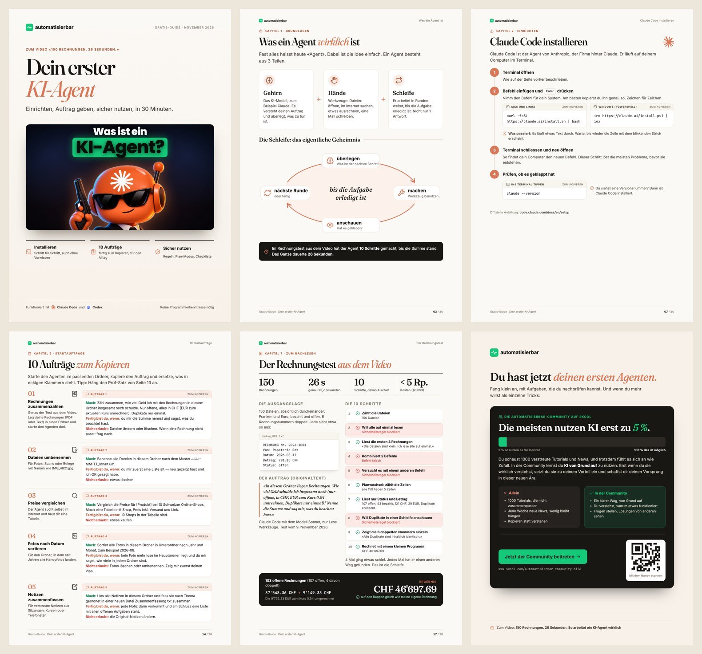

# Dein erster KI-Agent: der Gratis-Guide

Zum Video **«150 Rechnungen. 26 Sekunden. So arbeitet ein KI-Agent wirklich»**

## 📥 [Guide herunterladen (PDF, 20 Seiten)](Dein-erster-KI-Agent.pdf)

Das steht drin:

- **Was ein Agent wirklich ist:** Gehirn, Hände, Schleife. Dazu Chat oder Agent und die 3 Fragen gegen Fake-Agenten.
- **Claude Code oder Codex einrichten,** Schritt für Schritt, auch ohne Vorwissen (Mac und Windows).
- **Der Auftrag in 3 Teilen:** eine Vorlage, die du für jeden Auftrag nutzen kannst.
- **Sicher nutzen:** erst nur lesen lassen, Plan-Modus und der Prüf-Satz.
- **10 Aufträge zum Kopieren** für den Alltag: Rechnungen, Fotos, Excel-Listen, Reiseangebote, Mails und mehr.
- **Wenn es hakt:** die häufigsten Probleme und was hilft.
- **Der Rechnungstest und die Falle aus dem Video** zum Nachlesen.
- **Checkliste:** Bin ich startklar?

---

👉 **Mehr in der automatisierbar-Community auf Skool:** https://www.skool.com/automatisierbar-community-6126

Lerne KI von Grund auf zu nutzen, statt 1000 verstreute Tutorials zu schauen.
